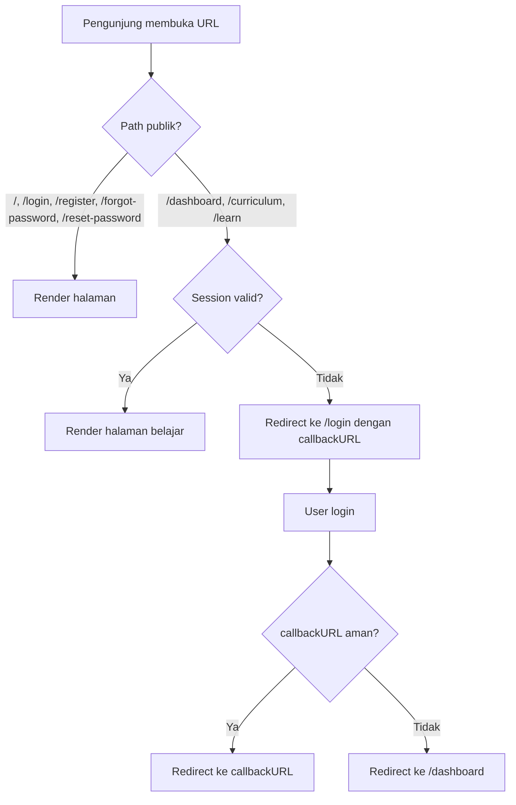
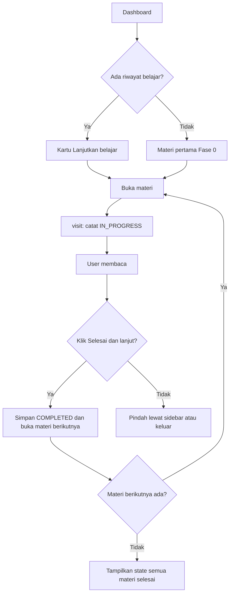
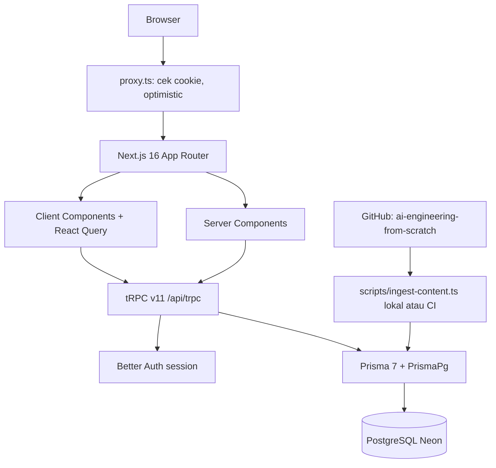
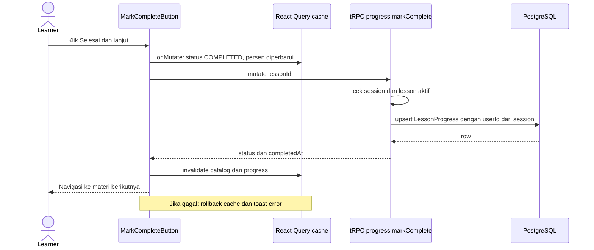
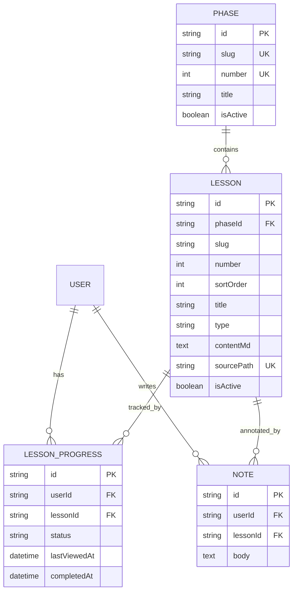

# PRD: AIE Learn

```
Project Name : AIE Learn (working title)
Tagline      : Kurikulum AI engineering open source, dibungkus pengalaman LMS: login, belajar berurutan, progress tersimpan.
Platform     : Web App (responsive)
Tech         : Next.js 16 + Better Auth + tRPC v11 + Prisma 7 + PostgreSQL (dari chndrwali/nextjs-starter-kit)
Auth         : Email/Password (Better Auth)
MVP Timeline : 2 minggu part-time (asumsi, lihat Open Questions)
```

---

## 1. Overview

**Problem.** Kurikulum `ai-engineering-from-scratch` ada sebagai repo GitHub: 542 lesson dalam 20 phase
(angka dari README upstream), tersebar sebagai markdown di `phases/NN-nama/NN-nama/docs/en.md`.
Untuk belajar mandiri jangka panjang ini menyulitkan: tidak ada tempat yang mencatat "sudah sampai mana",
tidak ada tombol "lanjutkan", dan berpindah antar lesson berarti membuka folder satu per satu.
README upstream menyebut progres dicatat oleh tutor skill (mis. `LEARNING.md`), yaitu file lokal, bukan web yang bisa dibuka dari device mana pun.

**Solution.** Web LMS pribadi: konten kurikulum di-ingest ke database, dibaca lewat lesson viewer yang rapi,
dan progres per user tersimpan di server. Semua area belajar hanya bisa diakses setelah login. Pengunjung anonim hanya melihat landing page.

**Success metrics.**

| Metric | Target |
| --- | --- |
| Progress tidak hilang | 0 kasus kehilangan data progress setelah re-sync konten |
| Waktu dari login ke materi terakhir | ≤ 2 klik |
| Respons tombol "Selesai" | UI berubah < 100 ms (optimistic), tersimpan < 1 detik |
| LCP halaman materi (p75, 4G) | < 2,5 detik |
| Konsistensi belajar (metrik pribadi) | aktif ≥ 3 hari per minggu |

**Assumptions.**

1. Konten upstream berlisensi MIT, boleh dipakai ulang dengan menyertakan copyright dan lisensi.
2. Gating adalah fitur produk (pengalaman LMS), bukan perlindungan rahasia. Repo upstream tetap publik.
3. Pengguna 1 sampai 20 orang. Tier gratis Neon dan Vercel cukup.
4. Hanya `docs/en.md` yang disimpan di database. Kode, notebook, dan `outputs/` lesson di-link ke GitHub.
5. Navigasi bebas, tanpa lock berurutan. README upstream sendiri menyarankan melompat jika sudah menguasai fondasi.
6. Konten (materi) berbahasa Indonesia — diterjemahkan dari `docs/en.md` upstream saat ingest; istilah teknis boleh tetap English; tautan ke sumber Inggris tetap ada di footer atribusi (keputusan Candra, 14 Nov 2026).
7. Nomor lesson upstream **tidak kontigu** (contoh dari README: Phase 10 melompat 22 → 25 → 34, Phase 8 melompat 14 → 19). Urutan ditentukan oleh sorting nomor folder, bukan asumsi 1..N.

**Risks and mitigations.**

| Risiko | Mitigasi |
| --- | --- |
| Upstream aktif berubah (2.600+ commit), folder bisa di-rename atau dihapus | Ingest pinned ke commit SHA. Lesson yang hilang di-`isActive=false`, tidak dihapus. Progress tidak pernah di-cascade-delete dari lesson. |
| Sebagian lesson belum lengkap (README menyebut "completed lesson") | Ingest melewati lesson tanpa `docs/en.md` atau terlalu pendek, lalu mencatatnya di report. |
| Markdown tak terduga (HTML mentah, LaTeX, mermaid) | Verifikasi di task T3 sebelum memilih plugin renderer. Tanpa raw HTML. |
| Lisensi | Footer atribusi + `THIRD_PARTY_NOTICES.md` berisi teks lisensi MIT upstream. |
| Terjemahan 542 lesson tidak konsisten / salah istilah | Glosarium istilah di `content-meta/glossary.json`; spot-check terjemahan di T3; sumber Inggris selalu ditautkan. |
| Scope creep ala LMS | MoSCoW ketat. Daftar "Won't have" dipatuhi. |
| Forgot password butuh email | Aktif hanya jika Resend dikonfigurasi. Jika tidak, link disembunyikan. |

---

## 2. User Personas and Stories

```
Persona: Learner (pemilik, self-learner)
- Background: Developer web (TypeScript/Next.js), ingin masuk ke AI engineering.
- Pain Points: Lupa sampai lesson mana; harus bolak-balik buka GitHub; progres tidak sinkron antar device.
- Goals: Belajar rutin, melihat kemajuan, melanjutkan dari titik terakhir dengan satu klik.
- Tech Literacy: High

Persona: Rekan yang diundang (opsional)
- Background: Teman yang ingin belajar kurikulum yang sama.
- Pain Points: Tidak mau setup repo dan environment hanya untuk membaca materi.
- Goals: Daftar, belajar, progres tersimpan sendiri.
- Tech Literacy: Medium

Persona: Owner/Admin
- Background: Pemilik aplikasi; menjalankan sync konten.
- Goals: Memperbarui konten dari upstream tanpa merusak progress siapa pun.
- Tech Literacy: High
```

**US-01.** Sebagai pengunjung, saya ingin melihat landing page yang menjelaskan isi kurikulum, agar saya tahu apa yang akan dipelajari sebelum mendaftar.
- [ ] `/` tampil tanpa login dan tidak me-redirect ke `/login`
- [ ] HTML landing tidak memuat isi materi (hanya judul fase dan jumlah materi)

**US-02.** Sebagai pengunjung anonim, saya tidak boleh membuka materi, agar pengalaman LMS konsisten.
- [ ] Akses `/dashboard`, `/curriculum/**`, `/learn/**` tanpa session → redirect ke `/login?callbackURL=<path>`
- [ ] Panggilan tRPC ke procedure materi tanpa session → `UNAUTHORIZED`

**US-03.** Sebagai learner, saya ingin kembali ke materi yang tadi saya tuju setelah login, agar tautan yang dibagikan tetap berguna.
- [ ] Login dari `/login?callbackURL=/learn/a/b` mengarah ke `/learn/a/b`
- [ ] `callbackURL` eksternal (`https://evil.com`, `//evil.com`) diabaikan, fallback `/dashboard`

**US-04.** Sebagai learner, saya ingin tombol "Lanjutkan belajar" di dashboard, agar tidak perlu mencari lesson terakhir.
- [ ] Menuju materi yang terakhir dibuka; jika sudah selesai, menuju materi belum selesai terdekat berikutnya
- [ ] Learner baru diarahkan ke materi pertama Fase 0

**US-05.** Sebagai learner, saya ingin menandai materi selesai dan langsung lanjut, agar alur belajar tidak terputus.
- [ ] Klik "Selesai dan lanjut" menyimpan status dan membuka materi berikutnya
- [ ] Setelah refresh atau login dari device lain, status tetap ada
- [ ] Status selesai bisa dibatalkan

**US-06.** Sebagai learner, saya ingin melihat daftar materi di sidebar dengan penanda selesai, agar tahu posisi saya dalam fase.
- [ ] Sidebar memuat materi fase aktif, penanda status, dan materi aktif tersorot
- [ ] Di layar < `lg`, sidebar menjadi Sheet

**US-07 (Should).** Sebagai learner, saya ingin mencatat catatan pribadi per materi, agar insight tidak hilang.

**US-08 (Should).** Sebagai learner, saya ingin mencari materi dengan Cmd+K, agar bisa melompat cepat.

**US-09 (Should).** Sebagai owner, saya ingin menjalankan sync konten yang aman, agar materi terbaru masuk tanpa merusak progress.
- [ ] Sync dijalankan dua kali berturut-turut: hasil identik, tidak ada perubahan data kedua kalinya
- [ ] Report menampilkan jumlah ditambah, diperbarui, dilewati, dan dinonaktifkan

---

## 3. Functional Requirements

### Must Have (MVP)

| ID | Requirement | Acceptance Criteria |
| --- | --- | --- |
| FR-001 | Landing page publik di `/` | Tanpa redirect. Berisi hero, ringkasan fase (judul + jumlah materi dari DB), cara kerja, CTA Daftar/Masuk, footer atribusi. User yang sudah login melihat tombol "Ke dashboard". |
| FR-002 | Auth email/password dari starter | Register, login, logout berfungsi. Setelah login → `callbackURL` aman atau `/dashboard`. Demo account info dihapus dari halaman login. |
| FR-003 | Gating area belajar | Lihat US-02. Dicek di tiga lapis: `proxy.ts`, layout `(learn)`, tRPC. |
| FR-004 | Katalog fase dan materi | Hasil ingest tersimpan. `/curriculum` menampilkan semua fase aktif, urut nomor, dengan jumlah materi dan persen progress user. |
| FR-005 | Halaman fase | `/curriculum/[phase]` menampilkan daftar materi urut, badge jenis (Konsep/Praktik), estimasi waktu, dan status per materi. |
| FR-006 | Lesson viewer | Render markdown: heading, tabel, code block ber-highlight + tombol salin, gambar, link internal antar materi, TOC, tombol sebelumnya/berikutnya (lintas fase). |
| FR-007 | Tandai selesai | Mutation idempotent. Optimistic update. Bisa dibatalkan. Status persist lintas device. |
| FR-008 | Resume | Sistem mencatat materi terakhir dibuka (`lastViewedAt`). Dashboard menampilkan "Lanjutkan belajar" sesuai US-04. |
| FR-009 | Agregasi progress | Persen per fase dan total = materi selesai ÷ materi aktif. Materi nonaktif tidak dihitung. |
| FR-010 | Sidebar silabus di lesson viewer | Lihat US-06. |
| FR-011 | Dashboard | Kartu Lanjutkan belajar, progress total, daftar fase dengan progress, 5 aktivitas terakhir. |
| FR-012 | Ingest konten | `npm run content:sync` idempotent, pinned ref, menghasilkan report. Spesifikasi di `CONTENT-PIPELINE.md`. |
| FR-013 | Atribusi lisensi | Footer landing dan lesson viewer menautkan ke repo upstream dan lisensi. `THIRD_PARTY_NOTICES.md` ada di repo. |
| FR-014 | Prasyarat | Teks `Prerequisites` dari header lesson ditampilkan di atas materi. Tidak mengunci akses. |
| FR-015 | Responsif dan aksesibel dasar | Dipakai nyaman di 375px. Fokus keyboard terlihat. WCAG AA untuk kontras teks. |
| FR-016 | Peta kurikulum statis di landing | Graf 20 fase (SVG) berdasarkan `phase-graph.json`. Lihat `DESIGN.md`. |

### Should Have

| ID | Requirement | Acceptance Criteria |
| --- | --- | --- |
| FR-101 | Catatan per materi | Satu catatan per (user, materi). Autosave dengan debounce 800 ms. Tidak ada konflik antar user. |
| FR-102 | Pencarian Cmd+K | Mencari judul dan motto materi (ILIKE). Hasil menuju materi. Memakai komponen `cmdk` yang sudah ada. |
| FR-103 | Streak dan heatmap | Dihitung dari `completedAt`. Memakai Recharts atau grid CSS. |
| FR-104 | Status sync di admin | Halaman `/admin/content`: ref, SHA, jumlah materi aktif, waktu sync terakhir (dari `ContentSync`). Hanya role admin. |
| FR-105 | Profil | Ganti nama dan password (`changePassword` sudah ada di auth client). |
| FR-106 | Peta kurikulum dengan progress | Peta di dashboard/curriculum: simpul memakai state belum/sedang/selesai. |
| FR-107 | Reset password via email | Aktif jika `RESEND_API_KEY` terisi. |

### Could Have

| ID | Requirement |
| --- | --- |
| FR-201 | Bookmark materi |
| FR-202 | Jalur belajar dari `learning-paths/*.json` upstream (MCP, Agent Skills, Reverse Engineering, dll) |
| FR-203 | Checklist latihan: parse bagian `## Exercises`, simpan centang per user |
| FR-204 | Tab "Ship It": tampilkan `outputs/prompt-*.md` dan `skill-*.md` lesson |
| FR-205 | Antrian review (spaced repetition) |
| FR-206 | Export progress ke JSON |
| FR-207 | Toggle bahasa (ditunda; MVP hanya menyimpan versi Indonesia) |

### Won't Have (for now)

- Pembayaran, langganan, sertifikat
- Forum, komentar, fitur sosial
- Kuis di dalam aplikasi (upstream menjalankan kuis lewat tutor skill, bukan data terstruktur)
- Eksekusi kode di browser
- AI tutor di dalam aplikasi
- Lock berurutan antar materi
- OAuth (Google/GitHub)
- Edit isi materi dari UI

---

## 4. Non-Functional Requirements

| Category | Requirement | Target |
| --- | --- | --- |
| Performance | LCP halaman materi (p75, 4G) | < 2,5 detik |
| Performance | Feedback tombol Selesai | < 100 ms (optimistic) |
| Security | Gating materi | 100% route belajar dan procedure materi butuh session |
| Security | Open redirect | `callbackURL` disanitasi, ada unit test |
| Security | Cookie | httpOnly, sameSite, secure di production (bawaan starter) |
| Security | Auth rate limiting | Bawaan Better Auth di starter, tidak dimatikan |
| Privacy | Data yang disimpan | Email, nama, progress, catatan. Tidak ada tracking pihak ketiga di MVP. |
| Accessibility | Standar | WCAG 2.2 AA untuk kontras dan keyboard; `prefers-reduced-motion` dihormati |
| SEO | Landing | Dapat diindeks. Semua halaman `(learn)` `noindex` dan di-disallow di `robots`. |
| Scalability | Beban | ≤ 20 user, ≤ ~600 materi. Cukup dengan indeks di `DATABASE.md`. |
| Availability | Uptime | Best effort (Vercel + Neon) |
| Durability | Backup | Neon branch/backup bawaan. FR-206 (export) sebagai cadangan pribadi. |
| Maintainability | Kualitas | TS strict, unit test untuk logika murni, e2e untuk 3 alur utama |

---

## 5. Core Features

### Feature: Gating area belajar

```
Priority: Must
Description: Tiga lapis. (1) proxy.ts mengecek cookie session secara optimistic dan me-redirect cepat.
  (2) app/(learn)/layout.tsx memvalidasi session di server dan redirect jika tidak valid.
  (3) protectedProcedure menolak panggilan tanpa session.
User Interaction:
  1. Pengunjung membuka /learn/a/b tanpa login
  2. Sistem redirect ke /login?callbackURL=%2Flearn%2Fa%2Fb
  3. Setelah login, sistem mengarahkan ke path semula
Edge Cases:
  - Cookie ada tapi session kedaluwarsa: lapis (2) mengalahkan lapis (1), redirect ke /login
  - callbackURL berisi URL absolut atau diawali //: diabaikan
  - User yang sudah login membuka /login: redirect ke /dashboard (perilaku (auth)/layout.tsx bawaan)
```

### Feature: Lesson viewer

```
Priority: Must
Description: Server Component membaca Lesson.contentMd dan merender via pipeline markdown.
  Header menampilkan judul, motto, jenis, bahasa, estimasi waktu, prasyarat.
User Interaction:
  1. User membuka /learn/[phase]/[lesson]
  2. Klien memanggil progress.visit sekali saat mount (status minimal IN_PROGRESS, lastViewedAt diperbarui)
  3. User membaca; TOC menyorot bagian aktif
  4. User klik "Selesai dan lanjut" atau memakai sidebar/prev/next
Edge Cases:
  - Slug tidak ditemukan atau lesson nonaktif: notFound()
  - Lesson tanpa metadata (Type/Time kosong): bagian itu disembunyikan, halaman tetap tampil
  - Link internal ke lesson yang tidak ada: sudah dialihkan ke GitHub saat ingest
  - Materi pertama dan terakhir: tombol sebelumnya/berikutnya disembunyikan
```

### Feature: Progress

```
Priority: Must
Description: Baris LessonProgress dibuat saat pertama kali materi dibuka (IN_PROGRESS) dan
  menjadi COMPLETED saat ditandai. Tidak ada baris = belum dimulai.
User Interaction:
  1. Klik Selesai dan lanjut → optimistic update (centang, persen) → mutation → navigasi
  2. Klik Batalkan selesai → status kembali IN_PROGRESS
Edge Cases:
  - Klik ganda: upsert idempotent, completedAt tidak berubah jika sudah COMPLETED
  - Mutation gagal: rollback cache, toast error, tombol aktif kembali
  - visit setelah COMPLETED: hanya lastViewedAt yang berubah, status tidak diturunkan
  - Lesson dinonaktifkan setelah sync: baris progress tetap ada, tidak dihitung ke persen
API:
  - progress.visit, progress.markComplete, progress.unmark, progress.overview, progress.continue
```

### Feature: Ingest konten

```
Priority: Must
Description: Script lokal/CI yang mengambil upstream pada ref tertentu, mem-parse lesson,
  menulis ulang link, lalu upsert ke database. Detail di CONTENT-PIPELINE.md.
Edge Cases:
  - Clone gagal atau hasil parse jauh lebih sedikit dari sync sebelumnya (< 80%): berhenti, butuh --force
  - Lesson tanpa docs/en.md atau terlalu pendek: dilewati dan dilaporkan
  - Lesson hilang di upstream: isActive=false, progress aman
```

---

## 6. User Flows

**Alur akses**



**Alur belajar**



---

## 7. System Architecture

- **Frontend**: Next.js 16 App Router. Server Components untuk halaman dan render markdown. Client Components untuk interaksi (tombol selesai, sidebar, TOC, Cmd+K).
- **API**: tRPC v11 + TanStack Query. Prefetch di server, hydrate di client.
- **Database**: PostgreSQL (Neon) lewat Prisma 7 + PrismaPg.
- **Storage file**: tidak dipakai di MVP (UploadThing bawaan starter dibiarkan tidak aktif).
- **Cache**: tidak ada Redis. Cache render per `contentHash` dipertimbangkan setelah MVP.
- **Queue**: tidak ada. Ingest dijalankan manual dari lokal/CI.





---

## 8. Database Schema

Model baru: `Phase`, `Lesson`, `LessonProgress`, `Note`, `ContentSync`. Model auth bawaan starter tidak diubah.
Definisi Prisma lengkap, indeks, dan query ada di `DATABASE.md`.



- **Soft delete**: `Phase` dan `Lesson` memakai `isActive`. Progress dan catatan tidak pernah ikut terhapus karena lesson.
- **Hard delete**: hanya saat user dihapus (cascade).
- **Normalisasi**: persen progress dihitung saat query, tidak disimpan.

---

## 9. API Design

Semua lewat tRPC (`/api/trpc`). Auth "Ya" berarti `protectedProcedure`. Detail perilaku di `backend_flow.md`.

| Procedure | Auth | Input | Output |
| --- | --- | --- | --- |
| `landing.outline` | Tidak | - | `{ totals, phases[{number,slug,title,tagline,lessonCount}] }` |
| `catalog.phases` | Ya | - | fase + `lessonCount`, `completedCount` |
| `catalog.phase` | Ya | `{ phaseSlug }` | fase + materi[{slug,number,title,type,estimatedMinutes,status}] |
| `lesson.get` | Ya | `{ phaseSlug, lessonSlug }` | materi (+`contentMd`), prev, next, status, note |
| `lesson.syllabus` | Ya | `{ phaseSlug }` | materi[{id,slug,title,status}] |
| `progress.visit` | Ya | `{ lessonId }` | `{ status }` |
| `progress.markComplete` | Ya | `{ lessonId }` | `{ status, completedAt }` |
| `progress.unmark` | Ya | `{ lessonId }` | `{ status }` |
| `progress.overview` | Ya | - | `{ totalLessons, completed, percent, perPhase[], recent[] }` |
| `progress.continue` | Ya | - | `{ lesson \| null, reason }` |
| `note.get` / `note.upsert` | Ya | `{ lessonId }` / `{ lessonId, body }` | catatan |
| `search.lessons` | Ya | `{ q }` | maks 10 hasil |
| `admin.syncStatus` | Admin | - | sync terakhir |

- **Error format**: `TRPCError` dengan kode `UNAUTHORIZED`, `NOT_FOUND`, `BAD_REQUEST`, `FORBIDDEN`. Pesan untuk user berbahasa Indonesia, tanpa stack trace.
- **Rate limiting**: auth memakai bawaan Better Auth. Mutation progress tidak dibatasi (idempotent, dibatasi `userId`).
- **Pagination**: tidak perlu di MVP (20 fase, ≤ ~50 materi per fase). Pencarian dibatasi 10 hasil.

---

## 10. Tech Stack

| Layer | Technology | Justification |
| --- | --- | --- |
| Frontend | Next.js 16, React 19, Tailwind v4, shadcn/ui | Sudah ada di starter |
| Markdown | react-markdown, remark-gfm, rehype-slug, `@shikijs/rehype` | Render di server, tanpa raw HTML. Math dan mermaid ditentukan di T3. |
| API | tRPC v11 + TanStack Query v5 | Sudah ada; type-safe end to end |
| Backend | Next.js route handlers | Tidak perlu service terpisah |
| Database | PostgreSQL (Neon) + Prisma 7 | Sudah ada; konten ±MB muat di tier gratis |
| Auth | Better Auth | Sudah ada; admin plugin untuk role owner |
| Script | `tsx` | Menjalankan ingest TypeScript |
| Test | Vitest (unit), Playwright (e2e) | Ditambahkan di T0 dan T11 |
| Hosting | Vercel | Starter dioptimalkan untuk ini |
| CI/CD | GitHub Actions (opsional) | Typecheck, lint, test |

---

## 11. Development Phases

**Phase 1: Fondasi dan data (minggu 1)**
- [ ] T0 Setup, T1 model DB, T2 script ingest, T3 sync pertama dan verifikasi
- [ ] T4 Gating dan landing sementara, T5 router tRPC

**Phase 2: Pengalaman belajar (minggu 2)**
- [ ] T6 Shell learner, T7 lesson viewer, T8 progress UX, T9 dashboard/curriculum/phase
- [ ] T10 Landing final + peta kurikulum

**Phase 3: Kualitas dan rilis**
- [ ] T11 E2E, T12 deploy dan hardening

**Phase 4: Enhancement (Should)**
- [ ] T13 Catatan, T14 Cmd+K, T15 Streak, T16 Admin sync status, T17 Profil, T18 Peta dengan progress

Detail per task: `TASKS.md`.

---

## 12. Testing Strategy

| Type | Tool | Cakupan |
| --- | --- | --- |
| Unit | Vitest | Pure function: hitung progress, resolusi "continue", parse metadata lesson, rewrite link, `getSafeCallbackUrl` |
| Integration | Vitest + DB test (Neon branch) | Procedure `progress.*` dan `lesson.get`: isolasi antar user, idempotensi, UNAUTHORIZED |
| E2E | Playwright | (1) anonim ditolak dan kembali ke materi setelah login, (2) register → buka materi → selesai → refresh → status tetap, (3) resume dari dashboard |
| Manual | Browser | 375px, mode terang/gelap, keyboard-only |

---

## 13. Open Questions

1. Registrasi dibuka untuk umum, atau hanya owner dan undangan? Default: terbuka. Opsi: env `REGISTRATION_OPEN`.
2. Apakah upstream punya `docs/id.md` atau versi bahasa lain per lesson? Terjawab 14 Nov 2026 (Candra): materi wajib Bahasa Indonesia, jadi diterjemahkan saat ingest meski upstream tidak menyediakan `docs/id.md`. FR-207 (toggle bahasa) ditunda.
3. Berapa lesson yang benar-benar lengkap? Dijawab oleh report sync pertama.
4. Apakah lesson memakai LaTeX dan mermaid? Dicek di T3 dengan grep sebelum menambah `remark-math`/`rehype-katex`/`mermaid`.
5. Timeline 2 minggu part-time realistis? Sesuaikan setelah T0 sampai T3.
6. Mau mulai dari fase berapa? Default "Lanjutkan" untuk learner baru adalah Fase 0 materi 1. README upstream punya tabel "Where to start" sesuai latar belakang (FR-202).
7. Forgot password: aktifkan Resend sekarang atau nanti?

## Final Checklist

- [x] Semua fitur Must punya acceptance criteria
- [x] Alur mencakup happy path dan edge case
- [x] Skema database dinormalisasi
- [x] API terdokumentasi
- [x] Keamanan dibahas (gating, redirect, markdown, otorisasi per user)
- [x] Fase pengembangan sesuai timeline asumsi
