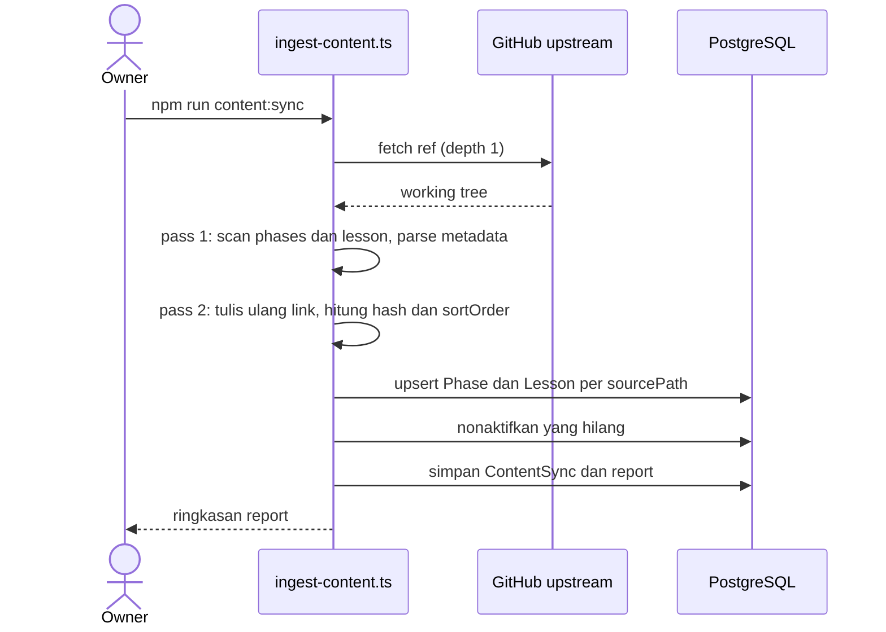

# backend_flow.md

Berlaku untuk tRPC router, logika server, dan script ingest. Skema data ada di `DATABASE.md`.

## Lapisan

```
Client / RSC
   │
   ▼
trpc/routers/<nama>.ts        tipis: validasi input (Zod), pilih procedure, panggil fungsi server
   │
   ▼
modules/learning/server/*.ts  logika + query Prisma (selalu menerima userId eksplisit)
   │
   ▼
modules/learning/lib/*.ts     pure function (tanpa I/O): hitung persen, resolusi "continue", dll
```

- Router baru didaftarkan di `trpc/routers/_app.ts`.
- Fungsi di `server/` tidak pernah membaca `userId` dari input. Router mengoper `ctx.auth.user.id`.
- Fungsi di `lib/` tidak mengimpor Prisma. Ini yang diuji dengan unit test.

## Daftar procedure

| Router.procedure | Tipe | Auth | Input (Zod) | Perilaku |
| --- | --- | --- | --- | --- |
| `landing.outline` | query | base | - | Fase aktif: `number, slug, title, tagline, lessonCount` + `totals`. **Allowlist.** Tidak boleh ada `contentMd` atau judul materi. |
| `catalog.phases` | query | protected | - | Semua fase aktif + `lessonCount` + `completedCount` milik user. |
| `catalog.phase` | query | protected | `{ phaseSlug }` | Fase + materi aktif urut `sortOrder` + status user per materi. `NOT_FOUND` jika slug tidak ada atau nonaktif. |
| `lesson.get` | query | protected | `{ phaseSlug, lessonSlug }` | Materi lengkap (`contentMd`), `prev`, `next` (ringkas: `slug, phaseSlug, title`), status user, catatan user. `NOT_FOUND` jika tidak ada atau nonaktif. |
| `lesson.syllabus` | query | protected | `{ phaseSlug }` | Daftar ringkas materi fase + status (untuk sidebar). Tanpa `contentMd`. |
| `progress.visit` | mutation | protected | `{ lessonId }` | Upsert, perbarui `lastViewedAt`. Tidak menurunkan `COMPLETED`. |
| `progress.markComplete` | mutation | protected | `{ lessonId }` | Upsert `COMPLETED`. `completedAt` tetap jika sudah selesai. |
| `progress.unmark` | mutation | protected | `{ lessonId }` | Jika ada baris: `IN_PROGRESS`, `completedAt = null`. Jika tidak ada: no-op. |
| `progress.overview` | query | protected | - | `totalLessons`, `completed`, `percent`, `perPhase[]`, `recent[5]`. |
| `progress.continue` | query | protected | - | Lihat aturan di bawah. |
| `note.get` | query | protected | `{ lessonId }` | Catatan user atau `null`. |
| `note.upsert` | mutation | protected | `{ lessonId, body: string.max(20000) }` | Upsert per (user, materi). `body` kosong → hapus baris. |
| `search.lessons` | query | protected | `{ q: string.min(2).max(80) }` | `ILIKE` judul dan motto, maks 10, hanya materi aktif. |
| `admin.syncStatus` | query | admin | - | Baris `ContentSync` terbaru + total materi aktif. |

Mutation menerima `lessonId` (cuid). Selalu validasi: lesson ada dan `isActive`. Jika tidak → `NOT_FOUND`.

## Aturan otorisasi

1. Semua kecuali `landing.outline` memakai `protectedProcedure`.
2. Semua query/mutation pada `LessonProgress` dan `Note` menyertakan `userId = ctx.auth.user.id` di `where`/`create`.
3. `admin.*` memakai `adminProcedure`. Role owner diberikan lewat kolom `role` (admin plugin Better Auth), bukan lewat UI.
4. Tidak ada procedure yang menerima `userId` dari client.

## Aturan "Lanjutkan" (`progress.continue`)

Fungsi murni `resolveContinue(lastViewed, lessonsOrdered, completedIds)` di `lib/`:

1. Tidak ada riwayat → `{ lesson: materi pertama aktif, reason: "start" }`.
2. Materi terakhir dibuka berstatus `IN_PROGRESS` → `{ lesson: itu, reason: "resume" }`.
3. Materi terakhir dibuka `COMPLETED` → materi pertama yang belum `COMPLETED` dengan `sortOrder` lebih besar; jika tidak ada, materi pertama yang belum `COMPLETED` secara global → `reason: "next"`.
4. Semua materi `COMPLETED` → `{ lesson: null, reason: "all-done" }`.

Unit test minimal: kasus 1 sampai 4, plus materi terakhir sudah dinonaktifkan (abaikan, pakai riwayat berikutnya).

## Agregasi progress

Fungsi murni `computePhaseProgress(totalsByPhase, completedPhaseIds)` → `{ phaseId, total, completed, percent }[]`.
`percent = total === 0 ? 0 : Math.round(completed / total * 100)`. Total keseluruhan dihitung dari jumlah, bukan rata-rata persen.

## Error handling

| Situasi | Kode | Pesan (Indonesia) |
| --- | --- | --- |
| Tidak ada session | `UNAUTHORIZED` | "Silakan masuk terlebih dahulu." |
| Bukan admin | `FORBIDDEN` | "Kamu tidak punya akses ke halaman ini." |
| Materi/fase tidak ada atau nonaktif | `NOT_FOUND` | "Materi tidak ditemukan." |
| Input tidak valid | `BAD_REQUEST` | Pesan Zod yang diterjemahkan secukupnya |
| Kegagalan tak terduga | `INTERNAL_SERVER_ERROR` | "Terjadi kesalahan. Coba lagi." (detail hanya di log server, tanpa data sensitif) |

## Caching dan invalidasi (sisi klien)

- Setelah `markComplete`/`unmark`: invalidate `catalog.phases`, `catalog.phase`, `lesson.syllabus`, `progress.overview`, `progress.continue`.
- Setelah `visit`: invalidate `progress.continue` saja.
- Konten materi berubah hanya lewat sync. Tidak perlu invalidasi runtime.

## Alur ingest (ringkas)

Detail lengkap di `CONTENT-PIPELINE.md`.



## Environment

| Variabel | Dipakai oleh | Catatan |
| --- | --- | --- |
| `DATABASE_URL` | Prisma | Neon, `sslmode=require` |
| `BETTER_AUTH_SECRET`, `BETTER_AUTH_URL` | Auth | Bawaan starter |
| `NEXT_PUBLIC_URL` | Klien/SEO | Bawaan starter |
| `RESEND_API_KEY` | Reset password | Opsional (FR-107) |
| `CONTENT_REPO_URL` | Ingest | Default `https://github.com/rohitg00/ai-engineering-from-scratch.git` |
| `CONTENT_REF` | Ingest | Branch, tag, atau SHA. Default `main`. Untuk pin, isi SHA. |

Semua variabel baru ditambahkan ke `.env.example` dan `lib/config-env.ts`.
